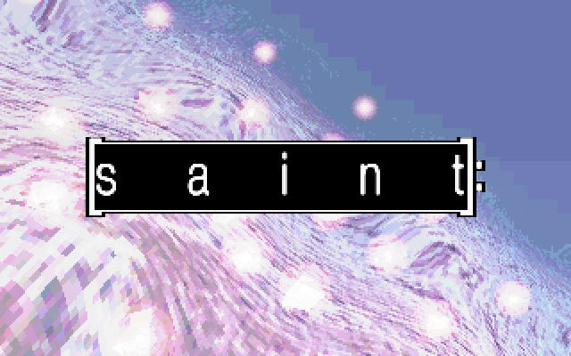
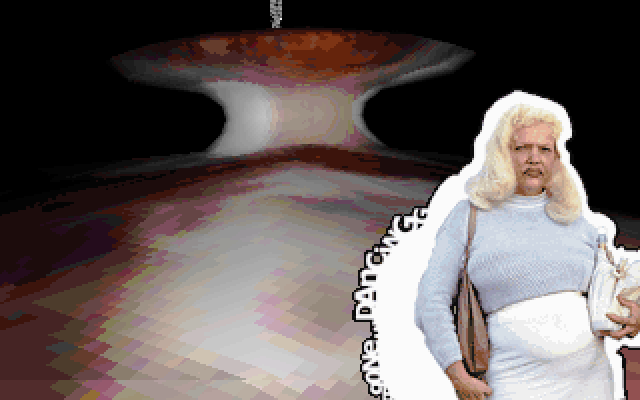
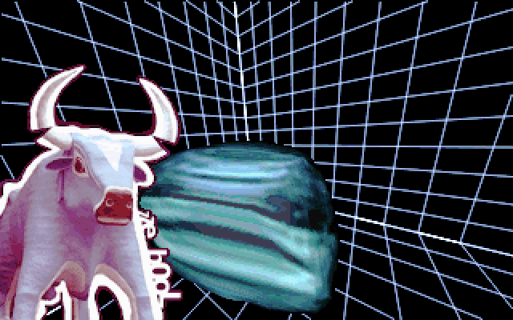
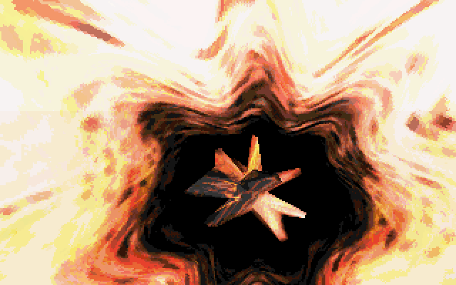

# Saint

Halcyon · demo · August 1997

- Code: Blitz, Placidity
- Player: Asmu
- Protected mode: Tran
- Meshes: Ren
- Graphics: Shrine, Placidity, Croaker
- Music: Naks, Pam and Vesuri of Da Jormas

Production: [Pouët](https://www.pouet.net/prod.php?which=296)

## ▶▶ [Watch the JS port here](https://kdrapel.github.io/halcyon-saint/release/)

<table>
<tr>
<td></td>
<td></td>
</tr>
<tr>
<td></td>
<td></td>
</tr>
</table>

These four stills are newly computed frames of the JavaScript port with its
original 640 × 400 palette. They are documentation images; the player renders
its graphics live and does not play screenshots or recorded video.

## Run on Windows

Double-click **Start.cmd**. It starts a local server and opens the player at
http://localhost:1997. Keep the server window open while watching; close it when
you are finished. Windows PowerShell is sufficient. No installation or npm
packages are needed.

Alternatively, with Node.js installed, run `node server.mjs` and open
http://localhost:1997. The folder can also be uploaded to a static web host.
Use a current browser with Web Audio and module support. Opening `index.html`
directly as a file does not work because browsers block loading the local
assets.

## Controls

- Space: play or pause
- Left / right: seek ten seconds; the −15s / +15s buttons jump fifteen seconds
- F: fullscreen
- Esc: stop and return to the title
- Drag the progress bar to choose a position; seeking starts when released.
- Stats for nerds: toggle displayed FPS, rendering time, the current scene,
  audio playback details, audio drift and a live four-channel S3M tracker. The
  switch is hidden by default and remains available in fullscreen when it was
  enabled before entering fullscreen.

The **Loading…** overlay stays visible during a seek until graphics and music
are ready. Graphics and audio checkpoints are stored every fifteen seconds; the
player restores the preceding state and computes forward. Live rendering has no
FPS cap and follows the soundtrack clock: if drawing takes longer, obsolete
drawings are skipped while the audio clock continues, and the stats panel shows
how far the displayed picture trails the music.

## Contents

The standalone package includes the translated JavaScript runtime in `app` and
`runtime`, the startup memory image, original soundtrack initialization data and
thirteen production assets required by the translated code. The original packed
opening film is embedded in the startup image and decoded live; playback starts
with that film and carries the soundtrack state into the rendered scenes. The
complete film-start sequence spans about 267 seconds.

Checkpoints store JavaScript execution state, not recorded frames or audio.
They are computed by the packaged renderer and mixer at the validated 10 Hz
cadence; these index units do not limit live rendering speed. The orange stop
in the geometry is fixed: the original FPATAN's quiet NaNs propagate correctly.
No oracle, capture archive, emulator, development tool or external service is
needed to run the player.

## Migration

The port follows the same reverse-engineering strategy as Nation Zero and
Bjoer: JavaScript generates the graphics, and the original S3M music data
drives a software mixer.

GPT models and a local model assisted with the port:

- **Sol 6.1** did most of the reverse-engineering, translation, integration and
  debugging.
- **Luna 6** contributed to a smaller part of the work.
- **Qwen 3.8 27B 2b Prism**, running locally on an AMD GPU, assisted with
  bounded analysis and review tasks.

## Migration Recipe

The practical workflow transferred the proven parts of the Nation Zero and
Bjoer process, then adapted them to Saint's own code and data.

1. **Start from the IDA disassembly.** The user disassembled the original
   final-version executable and provided a SQLite assembly index. Its indexed
   entries include DOS and extender code and misclassified data, so work
   focused on proven reachable Saint code, not all indexed functions.

2. **Build the oracle before porting.** Instrument DOSBox-X to export memory,
   CPU registers, x87 state and VGA state. The user operated the emulator and
   supplied snapshots; agents analyzed the artifacts offline and ran bounded
   comparisons around Unicorn.

3. **Recover routines and data.** Identify scene entry points, buffers, meshes,
   palettes, tracker state and the native S3M module. Preserve the original
   production data rather than recreating assets by eye.

4. **Translate behavior before simplifying it.** Keep a JavaScript execution
   path close to the original instructions, retaining memory layout, integer
   behavior and x87 precision, including floating-point operation order such
   as the FPATAN quiet-NaN propagation.

5. **Validate bounded pieces with Unicorn.** Start original machine code and JS
   from the same saved state, run to a defined boundary, and compare registers,
   memory, graphics buffers and palettes. Investigate the first mismatch before
   extending the translated path.

6. **Extend through complete scenes.** Connect the translated routines across
   the timeline and check visible results and scene progression against the
   documented scene ledger and reference captures.

7. **Replay music and align the clocks.** Retain the tracker's note, effect and
   envelope processing behind a software stereo mixer. Let the audio clock
   drive presentation, so slow graphics reduce their update rate without
   stopping the soundtrack.

8. **Optimize with evidence.** Replace hot instruction paths with direct
   JavaScript kernels while preserving operation order, and keep the uncapped
   live render loop following the consumed soundtrack clock.

9. **Package checkpoints and navigation.** Store graphics and audio execution
   state every fifteen seconds, using the validated 10 Hz computation cadence.
   Restore the preceding state and compute forward instead of playing cached
   frames or recorded sound. Rebuild the checkpoints after a runtime change
   with `node tools/build_release_seek.mjs` from the parent workspace.

10. **Check the experience and state the remaining limits.** Review playback,
    seeking, fullscreen and the stats panel in the browser, and keep unverified
    behavior explicit.

## Current limits

Executable startup has not been translated: the single startup memory image is
a required runtime input. Native hardware startup, exact production timing and
the audio pipeline's hardware model remain outside this browser scheduling
model. The runtime and checkpoints are specific to Saint; this package is not
a general-purpose DOS emulator or S3M player.
